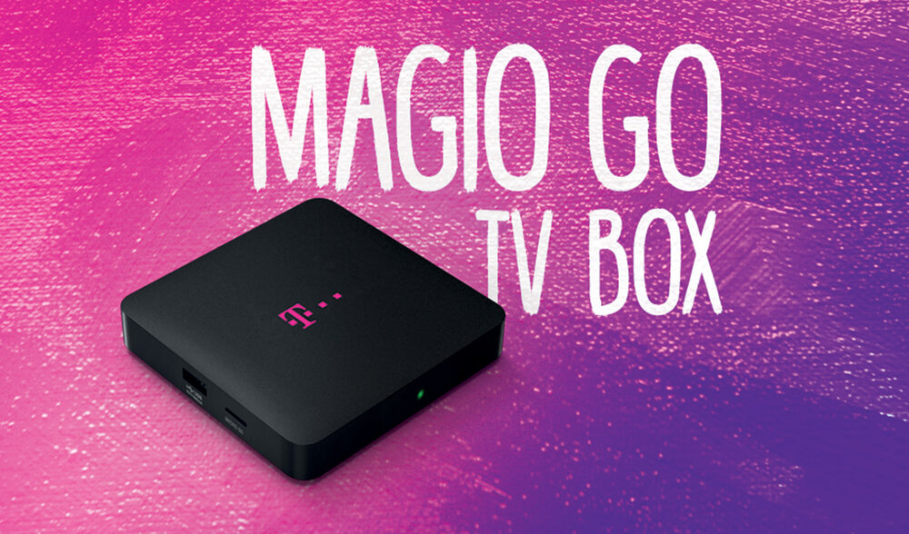

# Slovak Telekom Magio GO TV Box (HiSilicon Hi3798MV100)

**An old operator TV box turned into a small Linux server**: mainline Linux 6.6 and Alpine Linux on the
internal storage, with every important part of the chip working.

  
   Stock photo: <a href="https://a.storyblok.com/f/285923/x/50143105b4/magio-go-tv-box-prirucka-02_17.pdf">Slovak Telekom, Magio GO TV Box user manual (02/2017)</a>
  · launch: <a href="https://androidportal.sk/2017/02/telekom-prenosny-magio-go-tv-box-magio-go/">androidportal.sk, February 2017</a>

| | |
|---|---|
| Product | Slovak Telekom **Magio GO TV Box**, first generation (2017), model `G6O110SVT` (factory name `SlovakTelekom_SC7250`) |
| Board | HiSilicon "bigfish" reference design |
| SoC | HiSilicon **Hi3798MV100** (4× Cortex-A7 @ 1.2 GHz, Mali-450 MP2 GPU) |
| Memory | 1 GB DDR3, 4 GB eMMC |
| Connectivity | 100 Mbit Ethernet, Wi-Fi (Realtek RTL8192DU, 2.4 + 5 GHz), 1× USB 2.0, HDMI, IR receiver, SD slot |
| Stock firmware | Android 4.4.2 with a HiSilicon Linux 3.10 kernel (built April 2017), HiSilicon Fastboot 3.3.0 bootloader (a U-Boot derivative) |

More in [`hardware/HARDWARE.md`](hardware/HARDWARE.md).

## What I achieved

- **Booted Alpine from USB on the stock kernel** first, by borrowing the vendor's Android start-up just
  long enough to switch into Alpine
- **A full, verified copy of the 4 GB storage**, pulled over the network from the bootloader, before
  changing anything
- **Ported mainline Linux 6.6** with Alpine on the internal storage. It boots on its own after a power cut,
  and a rescue shell is built into the kernel
- **Wrote the missing drivers myself** (timers, CPU start-up, USB PHY, USB3 glue, GPU glue, temperature
  sensor, CPU frequency), using the vendor's open-source SDK and the stock kernel as references

Working: 4 CPU cores with frequency scaling and thermal protection, eMMC at full speed, Ethernet, USB,
Wi-Fi, GPU (OpenGL ES 2.0), hardware watchdog, temperature sensor, hardware random numbers, IR receiver,
and an HDMI console with my own boot logo. Not working yet: the SD card slot.

## The story in short

1. **[The stock box](docs/01-stock-box.md).** A serial console on the board showed the full boot log of
   Android and of the bootloader.
2. **[Alpine on the vendor kernel](docs/02-vendor-kernel-alpine.md).** The stock kernel only switches on
   USB once Android has started, so Alpine had to be reached through Android's own start-up.
3. **[A full copy of the storage](docs/03-emmc-backup.md).** Before writing anything, I copied the whole
   eMMC to my PC over the network, straight from the bootloader, and checked every piece.
4. **[Mainline Linux](docs/04-mainline-linux.md).** A new kernel for a chip that mainline Linux barely
   knows. The first problem: the wrong interrupt controller address, so no interrupt ever arrived.
5. **[Drivers](docs/05-drivers.md).** One part at a time: storage speed, network, USB, all 4 cores,
   temperature, GPU, Wi-Fi, IR, random numbers, HDMI.
6. **[Performance and cooling](docs/06-performance.md).** How fast it really is, and the cooling it needs
   to stay at full speed.

[Appendix: the SD card slot (open)](docs/appendix-sd-card.md)

## What made it possible

- **The bootloader is open.** It loads whatever kernel it is given, over the network or from the eMMC,
  and lets me edit its settings.
- **The vendor SDK is public** (GPL), so most register addresses and start-up sequences could be looked
  up instead of guessed. Where it was missing or wrong, the stock kernel binary told the rest.
- **Mistakes could always be undone.** With a full copy of the storage, a rescue shell in every kernel and
  test kernels started from RAM before flashing, nothing I tried was permanent.

## Repo layout

| Path | What |
|---|---|
| [`docs/`](docs/) | the write-up (start here) |
| [`hardware/`](hardware/) | the hardware reference (addresses, interrupts, clocks), stock boot log and system dump |
| [`bootloader/`](bootloader/) | eMMC backup tools, TFTP server, bootloader-settings editor, current settings |
| [`port/`](port/) | Linux port: kernel patches, config and device tree, build scripts, rescue shell, Alpine image builder |
| [`extras/`](extras/) | boot logo + HDMI, GPU tests, benchmarks, network tests, thermal logs |

**Not included:** the copy of the storage, vendor binaries and firmware, the vendor SDK, and build outputs.

## Disclaimer

For educational and research purposes, on hardware I own. Writing to the eMMC can brick a device.
Keep a full copy of the storage before you try anything.
